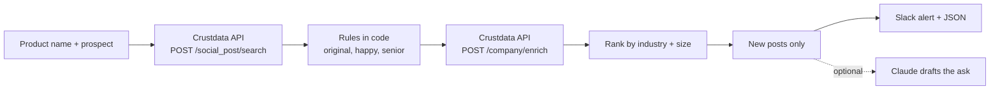

# Customer Reference Finder (Open Source, Slack Alerts)

**An open-source Python tool that finds customer references by searching public posts that mention your product, then ranks the authors by how well their company matches the prospect who needs a reference.**

Your best reference is often a customer who already posted about you. Most teams dig through old deals and settle for whoever they remember. This tool searches public posts for your product name, keeps the happy ones from people senior enough to say yes, checks each author's company industry and size, and sends your customer success manager a ranked list with a draft ask. [Crustdata](https://crustdata.com) is the social post and company data layer ([API docs](https://docs.crustdata.com)).


## How it works



1. **Search posts.** `POST /social_post/search` with `text [.] <product>` (the literal word must appear), `actor.actor_type = person`, `post_type = original` and `date_posted => <since>`.
2. **Filter.** Rules in code re-check every post. Each one has a unit test:
   - original posts only (no reposts, no company pages)
   - posted inside the window
   - the product name appears as a whole word
   - at least one happy-customer cue ("love", "recommend", "saved us", ...) and no complaint cue ("outage", "awful", "cancelled", ...)
   - the author has a title and a company, the title is senior (founder, chief, VP, head, director, manager, lead, ...)
   - the author does not work at your own company
3. **Enrich.** `POST /company/enrich` by exact company name, asking only for `basic_info` and `taxonomy.professional_network_industry`. A match is kept only when its name equals the name on the post, because a name can fuzzy-match several companies.
4. **Rank.** Industry match to the prospect (+3), same size band (+2) or adjacent band (+1), top-level title (+1), post with 10+ reactions (+1).
5. **Alert.** New posts only (`.state/seen.json`), Slack + `out/references.json`, with a draft ask for the top match.

## Quickstart

Requires Python 3.9+. No dependencies for the core tool.

```bash
git clone https://github.com/mhimed-crustdata/customer-reference-finder
cd customer-reference-finder
make setup        # creates .env, then add your CRUSTDATA_API_KEY and PRODUCT
make demo         # never posts to Slack
make run          # posts new references to SLACK_WEBHOOK_URL
make test         # unit tests, no network
```

Describe the prospect on the command line:

```bash
python3 reference_finder.py --product "Acme" --own-company "Acme" \
  --prospect "Globex" --prospect-industry "Software Development" --prospect-size 201-500
```

Run it every morning with cron (`0 8 * * * cd /path/to/repo && make run`) or a scheduled CI job with your keys stored as secrets.

## Configuration

| Variable | Default | What it does |
|---|---|---|
| `CRUSTDATA_API_KEY` | required | Your Crustdata API key. Read from the environment only |
| `PRODUCT` | required | Product name to search for in public posts |
| `OWN_COMPANY` | empty | Authors whose company contains this name are skipped |
| `PROSPECT_INDUSTRY` | empty | Industry of the prospect, as in the company industry field |
| `PROSPECT_SIZE` | empty | Headcount band of the prospect: `2-10`, `11-50`, `51-200`, `201-500`, `501-1000`, `1001-5000`, `5001-10000`, `10001+` |
| `SINCE_DAYS` | `30` | How far back to look for posts |
| `SLACK_WEBHOOK_URL` | empty | Slack incoming webhook. Empty means no Slack post |
| `ANTHROPIC_API_KEY` | empty | Optional Claude step (`--claude`) |
| `ANTHROPIC_MODEL` | `claude-opus-5-5` | Model for the optional Claude step |

Flags: `--max-posts` (default 50), `--max-companies` (default 10, caps enrichment), `--dry-run`, `--all`.

Output files in `out/` contain personal data and are git-ignored.

## Example output

A real run of the search on 2026-10-28 against the live API, looking for original posts by people that mention a well-known workplace chat product, dated 2026-08-15 or later. Individuals are not shown.

```json
{
  "original_posts_matching": 4149,
  "posts_matching_incl_reposts": 6200,
  "sample_of_original_posts": {
    "posts": 8,
    "with_author_title_and_company": 8,
    "with_a_happy_customer_cue": 1
  },
  "company_enrich_on_8_company_names_from_posts": {
    "resolved_to_exactly_one_company": 6,
    "fuzzy_matched_3_companies": 2,
    "by_size": {"51-200": 4, "other": 4}
  }
}
```

Two things the run taught the rules:

- Sorted by reactions, a sample of 20 matching posts was 20 reposts. That is why the query asks for `post_type = original`.
- Most original mentions are not testimonials: 1 in 8 carried a happy-customer cue. The happy and complaint cues in code are what turn thousands of mentions into a short list. A product name that is also a common word needs the whole-word rule and the cue rule even more.

The post index trails real time by a few weeks, so a very short window can return nothing. Use `--since-days 60` or more when you start.

What the Slack alert looks like (redacted):

```text
:speech_balloon: 3 customers posted about [Product]. Best matches for [Prospect]:
• [Title], [Company] ([Industry] · [Size]) · match 7 · [post URL]
  > [first 140 characters of the post]

Draft ask for the top match:
Hi, I saw your post about [Product] and it made my day. We are talking with [Prospect] and a short call with someone in your seat at [Company] would help a lot. Would you be open to a 20 minute reference call this month? [CSM name]
```

## How to build a customer reference agent

1. **Define the signal as data.** A reference candidate is an original public post that names your product, written by a senior person, with a positive tone.
2. **Choose the documented Crustdata calls and filters.** `/social_post/search` for the posts, `/company/enrich` for industry and size.
3. **Write the rules in code, not in a prompt.** Tone cues, seniority and the own-employee rule are plain regular expressions you can test.
4. **Only alert on what's new.** Post URLs go into `.state/seen.json` so the CSM sees each post once.
5. **Use the model for the words, not the list.** Claude drafts the ask from the post and the role. The ranking stays deterministic.
6. **Push it where people work.** Slack, CSV, CRM. For real time, see Crustdata watch endpoints in the [docs](https://docs.crustdata.com).

## FAQ

**How to find customer references?**
Search public posts for your product name, keep original posts from senior people with a positive tone, and match their company's industry and size to the prospect. This tool does that with two Crustdata calls and ranks the result for your customer success manager.

**How does it avoid noise?**
It drops reposts and company pages, requires the product name as a whole word, requires a happy cue and no complaint cue, skips your own employees, and keeps a company match only when the name is exact.

**Does it contact anyone?**
No. It only posts to your own Slack webhook when `SLACK_WEBHOOK_URL` is set and `--dry-run` is off. The CSM sends the ask.

**Is Claude required?**
No. It is optional and off unless `ANTHROPIC_API_KEY` is set and you pass `--claude`. Without it the draft ask comes from a template.

**Which Crustdata endpoints does it use?**
`POST /social_post/search` and `POST /company/enrich` on API version `2025-11-01`. See the [Crustdata API docs](https://docs.crustdata.com).

## Project layout

```text
reference_finder.py # the workflow
crustdata_api.py    # tiny Crustdata client (stdlib only)
notify.py           # optional Slack + Claude
tests/              # unit tests, no network
```

## License

MIT. See [LICENSE](LICENSE). Data layer: [Crustdata](https://crustdata.com) ([docs](https://docs.crustdata.com)).
